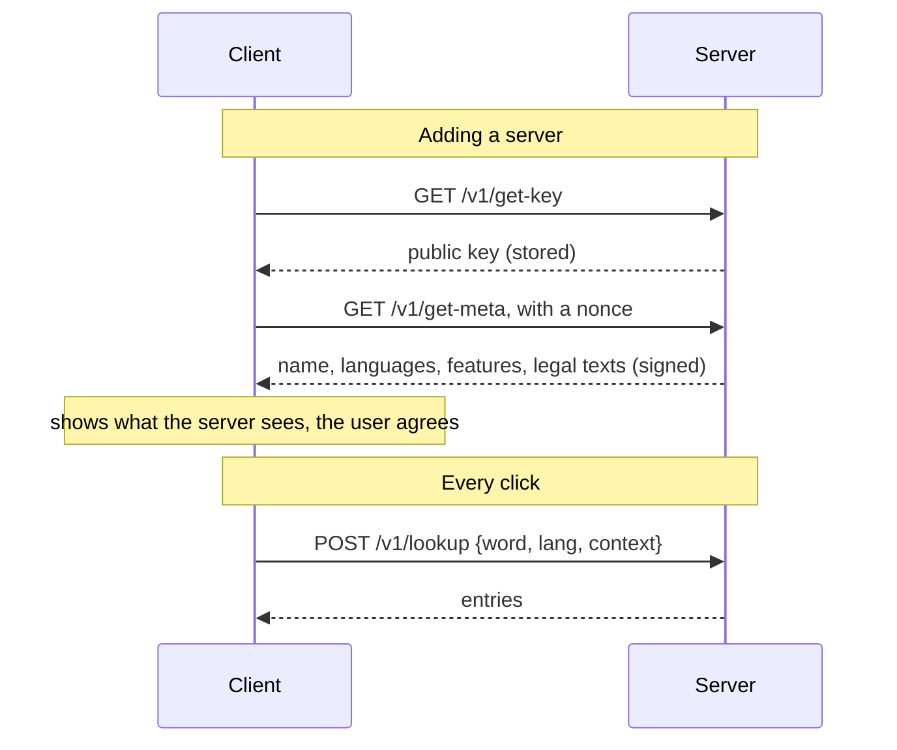

# d0 lookup protocol

**Look up a word in the sentence where you met it.**

The d0 lookup protocol is how a reading app (the *client*) asks a dictionary *server* about a word. The client sends the word you clicked, and the sentence around it if you allow that; the server answers with dictionary entries, and says which part of the sentence they belong to.

Any client works with any server. A user adds the servers they trust and picks one per language.

## What it gives you

- **Words in their sentence.** With the sentence, a server finds what a single word can't show: phrases (`tritt … in Kraft` → *in Kraft treten*), separable verbs (`fand … statt` → *stattfinden*), and the whole word in scripts without spaces (`食` in `食べました` → *食べる*). It tells the client which parts of the sentence it matched, so the client can underline them.
- **One shape for every language.** Headword, part of speech ([Universal Dependencies](https://universaldependencies.org/u/pos/)), grammar labels, pronunciation (IPA, audio, a reading in kana or Latin letters), meanings, and a split of compounds and endings (`Rettung|s|fonds`, `talo|ssa`).
- **Servers you can recognise.** Every server has its own Ed25519 key and signs its metadata. If a server's key ever changes, the client warns the user before trusting it again.
- **Privacy the user can count on.** The client, not the server, tells the user what a server sees, from what the protocol says. When a server's privacy policy or terms change, the client stops sending lookups until the user has seen the change.
- **Credit for the data.** A server lists its sources and their licences, and the client credits them. Links in an answer can only point to the sources the server listed.

## How it works



A lookup, for `Kraft` in *Das Gesetz tritt morgen in Kraft.*:

```jsonc
// POST /v1/lookup
{ "word": "Kraft", "lang": "de_en", "context": "Das Gesetz tritt morgen in Kraft." }
```

```jsonc
{
  "entries": [
    {
      "lemma": "in Kraft treten",
      "pos": "VERB",
      "senses": [{ "glosses": ["to come into force"] }],
      "match": ["tritt", "in Kraft"]   // the parts of the sentence this entry covers
    },
    {
      "lemma": "die Kraft",
      "pos": "NOUN",
      "senses": [{ "glosses": ["strength", "force"] }]
    }
  ]
}
```

## Read more

| Document | For |
| --- | --- |
| [PROTOCOL.md](PROTOCOL.md) | The full protocol: every endpoint, field and rule, for clients and servers. When documents disagree, this one is right. |
| [SERVER.md](SERVER.md) | Building a server: what a server has to do, step by step, with links into the full protocol. |

## Implementations

- **[dict-server-ts](https://github.com/d0-lang/dict-server-ts)**: a server for German, Spanish, French, Italian, Japanese, Polish, Russian and Ukrainian, built from Wiktionary. You can run your own; **DaDict public** at `https://server.dadict.com` is the one we run.
- **[DaDict](https://github.com/d0-lang/extension)**: a browser extension, the client. Click a word on any page and see what it means there.

## Versions

Every path starts with the version: `/v1/get-key`. Within `v1`, only optional additions happen (a new field, query parameter or `features` string), and clients ignore what they don't know. Anything else is a new version.

## Changing the protocol

Every server and every client has to follow a change, so start with an issue that says what you want to change and why.

## Licence

[MIT](LICENSE)
